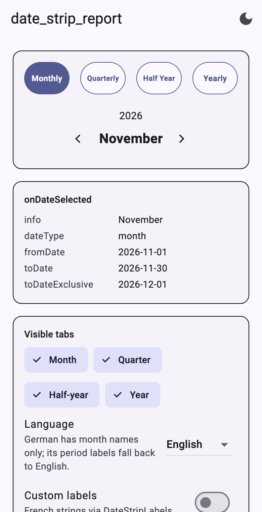
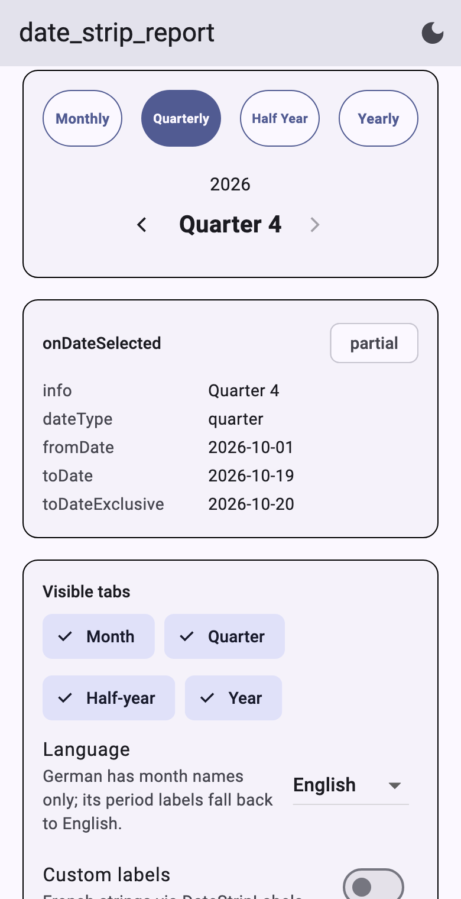
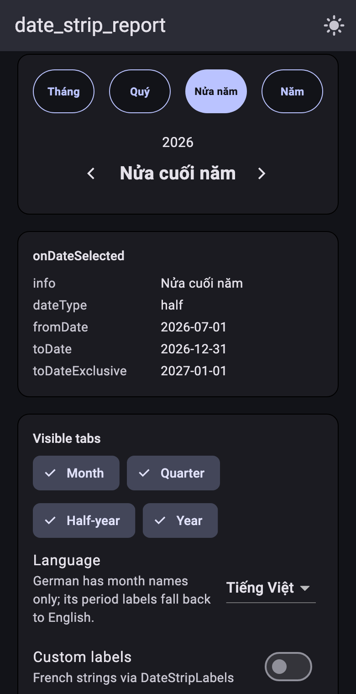
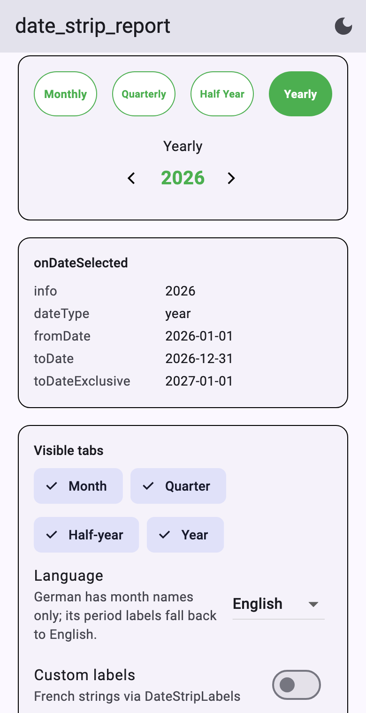

# date_strip_report

A report-period selector for Flutter. Users switch between **month, quarter,
half-year and year**, step through periods with previous/next buttons, and
your app receives the selected period as an inclusive `fromDate`–`toDate`
range — optionally limited to a date range.

<p align="center">
  
  
  
  
</p>

## Features

- Month, quarter, half-year and year tabs; hide the ones you don't need.
- Optional date range with a precise contract: partially overlapping periods
  are selectable and their dates are clamped, so results never leave the
  range.
- Built-in month names for 29 languages; period labels in English,
  Vietnamese, Chinese, Japanese and Korean; custom labels for anything else.
- Follows your app's `ThemeData` (light and dark), or takes explicit colors.
- Accessible: 48 dp touch targets, screen-reader labels and announcements,
  keyboard navigation, right-to-left support.
- Pure Dart and Flutter — no third-party dependencies, no platform code.

## Platform support

The package contains no platform-specific code.

| Platform | Status |
| --- | --- |
| Android | Example app built (debug APK) |
| iOS | Example app built (`--no-codesign`) |
| Web | Example app built |
| macOS, Windows, Linux | Expected to work (pure Flutter); not built or tested |

## Installation

```sh
flutter pub add date_strip_report
```

or add it to `pubspec.yaml`:

```yaml
dependencies:
  date_strip_report: ^2.0.0
```

## Usage

```dart
import 'package:date_strip_report/date_strip_report.dart';

DateStripReport(
  onDateSelected: (ResultDate result) {
    // e.g. 2026-11-01 .. 2026-11-30, "November"
    loadReport(from: result.fromDate, to: result.toDate);
  },
)
```

`onDateSelected` is called once after the first frame with the initial
selection, then on every user change.

### Limit the selectable range

```dart
DateStripReport(
  startDate: DateTime(2024, 3, 15), // first selectable day (inclusive)
  endDate: DateTime(2026, 10, 20),  // first day NOT selectable (exclusive)
  initialDateType: DateType.quarter,
  onDateSelected: print,
)
```

### Pick the visible tabs and the starting period

```dart
DateStripReport(
  isShowMonth: false,
  isShowHalfYear: false,
  initialDate: DateTime(2025, 7, 1),
  initialDateType: DateType.year,
  onDateSelected: print,
)
```

### Languages and custom labels

```dart
// Built-in language
DateStripReport(locale: LocaleType.vi, onDateSelected: print)

// Your own strings, starting from a built-in set
DateStripReport(
  labels: DateStripLabels.forLocale(LocaleType.fr).copyWith(
    monthly: 'Mensuel',
    quarterly: 'Trimestriel',
    halfYearly: 'Semestriel',
    yearly: 'Annuel',
    quarters: ['T1', 'T2', 'T3', 'T4'],
    halves: ['S1', 'S2'],
    previousPeriod: 'Période précédente',
    nextPeriod: 'Période suivante',
  ),
  onDateSelected: print,
)
```

### Colors

By default the widget uses your theme's `ColorScheme` (`primary`, `surface`,
`onSurface`). Pass colors to override it — this reproduces the 1.x look:

```dart
DateStripReport(
  selectedColor: Colors.green,
  unSelectedColor: Colors.white,
  textColor: Colors.green,
  navigationColor: Colors.black,
  navigationDisableColor: Colors.black12,
  onDateSelected: print,
)
```

A complete demo is in [`example/`](example/).

## Date-range behavior

- `startDate` is **inclusive**, `endDate` is **exclusive**, times of day are
  ignored, and either may be omitted. `startDate` must be before `endDate`.
- A period is selectable when **at least one of its days** is in the range.
  Its reported `fromDate`/`toDate` are clamped to the range and
  `isPartial` is `true`. The tab still shows the full period name
  (e.g. "Quarter 4").
- Previous/next are disabled when the adjacent period has no selectable day.
- `initialDate` (default: today) is moved to the nearest selectable day.
  Switching tabs returns to the period containing `initialDate`.
- Changing `startDate`, `endDate`, `locale`, `labels` or the visible tabs at
  runtime is applied immediately; if the result changes, `onDateSelected` is
  called again after the frame.

Example with `startDate: 2024-03-15`, `endDate: 2024-10-20`:

| Selected period | `fromDate` | `toDate` | `isPartial` |
| --- | --- | --- | --- |
| March 2024 | 2024-03-15 | 2024-03-31 | true |
| Quarter 2 2024 | 2024-04-01 | 2024-06-30 | false |
| Quarter 4 2024 | 2024-10-01 | 2024-10-19 | true |
| Year 2024 | 2024-03-15 | 2024-10-19 | true |
| February 2024 / Quarter 1 2025 | not selectable | | |

`toDate` is the last day at midnight. To filter timestamps, use
`ts >= fromDate && ts < toDateExclusive`.

## Accessibility and keyboard

- Tabs expose button, selected and mutually-exclusive-group semantics.
- Previous/next buttons have tooltips (`DateStripLabels.previousPeriod` /
  `nextPeriod`) and a disabled state.
- The selected period (e.g. "2026, November") is a live region, so screen
  readers announce changes.
- **Tab** moves focus, **Enter**/**Space** activates, and **←/→** step to the
  previous/next period while focus is inside the widget (mirrored in RTL).
- Tests check Flutter's tap-target, labeled-tap-target and text-contrast
  guidelines in light and dark themes.

## API reference

### `DateStripReport`

| Property | Type | Default | Description |
| --- | --- | --- | --- |
| `onDateSelected` | `ValueChanged<ResultDate>?` | `null` | Called with the selected period. |
| `startDate` | `DateTime?` | `null` | First selectable day (inclusive). |
| `endDate` | `DateTime?` | `null` | First non-selectable day (exclusive). |
| `initialDate` | `DateTime?` | today | Day whose period is selected first. |
| `initialDateType` | `DateType?` | first visible tab | Tab selected first. |
| `isShowMonth` / `isShowQuarter` / `isShowHalfYear` / `isShowYear` | `bool` | `true` | Tab visibility; at least one must be `true`. |
| `locale` | `LocaleType` | `LocaleType.en` | Built-in strings. |
| `labels` | `DateStripLabels?` | `null` | Custom strings; overrides `locale`. |
| `leftIcon` / `rightIcon` | `Icon?` | `arrow_back_ios` / `arrow_forward_ios` | Navigation icons (15 px unless the icon sets a size). |
| `selectedColor` | `Color?` | `colorScheme.primary` | Selected tab fill, tab borders, unselected tab text. |
| `unSelectedColor` | `Color?` | `colorScheme.surface` | Unselected tab fill, selected tab text. |
| `textColor` | `Color?` | `colorScheme.onSurface` | Period name. |
| `navigationColor` | `Color?` | `colorScheme.onSurface` | Enabled arrows. |
| `navigationDisableColor` | `Color?` | `onSurface` at 38 % | Disabled arrows. |

`DateStripReportState.selectedResult` returns the current selection (use a
`GlobalKey<DateStripReportState>`).

### `ResultDate`

| Member | Type | Description |
| --- | --- | --- |
| `fromDate` | `DateTime` | First day (inclusive, local midnight). |
| `toDate` | `DateTime` | Last day (inclusive, local midnight). |
| `toDateExclusive` | `DateTime` | Day after `toDate`. |
| `info` | `String` | Localized period name, e.g. "November", "Quarter 4", "2026". |
| `dateType` | `DateType` | `month`, `quarter`, `half` or `year`. |
| `isPartial` | `bool` | `true` when dates were clamped to the range. |

### `DateStripLabels`

Tab titles (`monthly`, `quarterly`, `halfYearly`, `yearly`), period names
(`months` ×12, `quarters` ×4, `halves` ×2), `yearPattern` (e.g. `'{year}年'`)
and button labels (`previousPeriod`, `nextPeriod`). Lists of the wrong length
fall back to English. Use `DateStripLabels.forLocale(locale)` and `copyWith`.

Full API documentation is generated by `dart doc` and published on pub.dev.

## Compatibility

| | Supported |
| --- | --- |
| Dart | 3.4 or newer |
| Flutter | 3.22 or newer |
| Verified locally | Flutter 3.29.0 / Dart 3.7.0 on macOS |
| CI | Flutter 3.22.x, 3.29.0 and latest stable ([workflow](.github/workflows/ci.yml)) |

## Migrating from 1.x

Most apps only need to bump the version. Check these points:

1. **Callback type.** `onDateSelected` is `ValueChanged<ResultDate>?`.
   `(data) { … }` and `(ResultDate r) { … }` keep working; callbacks declaring
   another parameter type must change.
2. **`ResultDate` fields are non-null.** Remove `!` / `?.` (they only cause
   warnings). Code that created `ResultDate()` or assigned its fields must
   use the new constructor.
3. **First callback timing.** It now arrives after the first frame. Don't
   rely on it having run before your own `build`.
4. **Colors.** Defaults now come from the theme. To keep the 1.x look pass
   `selectedColor: Colors.blue, unSelectedColor: Colors.white,
   textColor: Colors.black, navigationColor: Colors.black,
   navigationDisableColor: Colors.black12`.
5. **Label text.** If you compare `ResultDate.info` strings, note the new
   English quarter/half names and the corrected CJK labels. Prefer
   `dateType` and the dates for logic.
6. **Ranges.** Results are clamped to the range and a range excluding today
   no longer throws. An empty or inverted range throws `ArgumentError`.
7. **Deprecated members** (`SlideFadeTransition`, `DateUtils`,
   `DateStripReportState.getNextMonth`, …) still work and will be removed in
   3.0.0.

## Screenshots and demo recording

The screenshots above are rendered from the example app:

```sh
cd example
flutter test screenshots/screenshots_test.dart --update-goldens
```

They are written to `images/`. To record a GIF, run the example
(`flutter run -d chrome` or on a device), record the screen with your OS tool
(macOS: <kbd>Shift</kbd>+<kbd>⌘</kbd>+<kbd>5</kbd>; Android: `adb shell
screenrecord demo.mp4`), and convert it, e.g.
`ffmpeg -i demo.mp4 -vf "fps=12,scale=360:-1" demo.gif`.

## Known limitations

- Periods are calendar-based: quarters start in January, April, July and
  October, years in January. Fiscal years are not supported.
- Period labels are built in for English, Vietnamese, Chinese, Japanese and
  Korean only. Other locales show their month names with English period
  labels unless you pass `labels`. The Chinese, Japanese and Korean labels
  have not yet been reviewed by native speakers.
- The widget does not read `Localizations`/`Locale` from the app; choose the
  language with `locale` or `labels`.
- Dates are local calendar dates at midnight; UTC inputs are interpreted by
  their year/month/day fields.
- `initialDate` and `initialDateType` are only read when the widget is first
  created (like an initial value).
- There is no controller for programmatic navigation yet.
- `LocaleType.jp` and `LocaleType.cat` are not ISO 639-1 codes (`ja`, `ca`);
  they are kept for compatibility.

## Contributing

Issues and pull requests are welcome. Before opening a PR, run:

```sh
dart format lib test example/lib example/test
flutter analyze
flutter test
(cd example && flutter test)
```

## License

MIT — see [LICENSE](LICENSE). Parts of the code are derived from
[calendar_strip](https://github.com/IronLad85/flutter_calendar_strip)
(BSD-3-Clause) and
[flutter_datetime_picker](https://github.com/Realank/flutter_datetime_picker)
(MIT); see [THIRD_PARTY_NOTICES.md](THIRD_PARTY_NOTICES.md).

## Support

If this package saves you time, you can
[buy me a coffee](https://www.paypal.me/nguyengiap/5).
